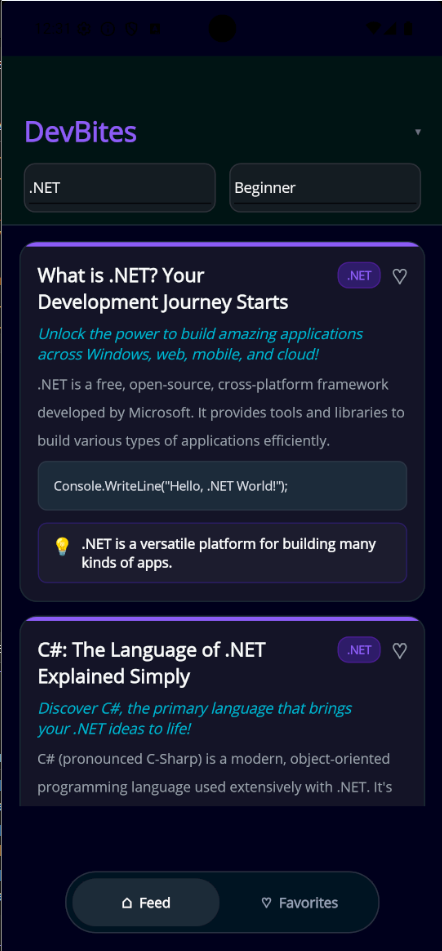

# DevBites

`DevBites` is a `.NET MAUI` app that delivers short, engaging programming concept cards in an infinite-scrolling feed.

It uses `Microsoft.Extensions.AI` (`IChatClient`) so the AI provider is swappable between **Gemini** and **Ollama** via `.env` config.

---

## Screenshots




---

## Feature Overview

- Infinite scrolling AI-generated feed
- Topic filter (`.NET`, `Python`, `OOP`, `SOLID`, `Design Patterns`, `Data Structures`)
- Expertise filter (`Beginner`, `Medium`, `Advanced`, `Pro`)
- Collapsible custom header
- Reusable card and header UI components (`ContentView` controls)
- Favorite reels (heart toggle per card)
- Persistent favorites stored locally in `SQLite`
- Feed/Favorites bottom tab bar UI
- AI provider switching through `.env` (`gemini` / `ollama`)
- Structured output enforcement using JSON schema via `IChatClient` response format

---

## Design Overview

`DevBites` uses an MVVM-first design that keeps UI, state, and data responsibilities separated.

### UI Experience

- `FeedPage` hosts the complete screen layout, including:
  - collapsible top header
  - main content region
  - loading and error status area
  - bottom tab-style switch between **Feed** and **Favorites**
- `FeedHeaderView` is a reusable header component with topic and expertise pickers.
- `ReelCardView` is a reusable card component used in both feed and favorites lists.

### State and Interaction

- `FeedViewModel` manages:
  - active reels and favorite reels
  - selected topic and expertise
  - pagination and cancellation logic
  - toggling favorites
  - switching between feed and favorites sections

### Data and Persistence

- `AIContentService` requests and parses AI-generated reels.
- `FavoritesService` persists saved reels in local `SQLite` (`devbites.db3`).
- `DotEnvLoader` + `Constants` provide runtime config for provider/model settings.

### AI Integration

- `IChatClient` abstraction keeps provider logic decoupled.
- Provider is selected at startup (`gemini` or `ollama`) from `.env`.
- JSON schema response format is applied to encourage strongly structured output.

---

## Key Components

### `Models/ProgrammingReel.cs`

- Represents one concept card returned by AI
- Uses `JsonPropertyName` mappings
- Includes UI-only `IsFavorite` state (not serialized)

### `Services/AIContentService.cs`

- Builds prompt using selected topic + expertise level
- Uses `IChatClient.GetResponseAsync`
- Enforces structured response format with JSON schema
- Parses response into `List<ProgrammingReel>`

`IAIContentService` signature:

```csharp
Task<IReadOnlyList<ProgrammingReel>> GetReelsAsync(
    string topic,
    string expertiseLevel,
    CancellationToken cancellationToken = default);
```

### `Services/FavoritesService.cs`

- Uses `sqlite-net-pcl`
- Stores favorites in local db file (`devbites.db3`)
- Supports toggle favorite, list favorites, and favorite-id lookup

### `ViewModels/FeedViewModel.cs`

Main state + commands:

- `Reels`, `FavoriteReels`
- `SelectedTopic`, `SelectedExpertiseLevel`
- `ShowFeedCommand`, `ShowFavoritesCommand`
- `ToggleFavoriteCommand`
- `LoadInitialCommand`, `LoadMoreCommand`
- Cancellation-aware refresh when topic/expertise changes

---

## Configuration

The app loads `.env` from an embedded resource at startup.

Example:

```dotenv
AI_PROVIDER=gemini

GEMINI_API_KEY=your_key
GEMINI_MODEL=gemini-2.5-flash-lite

OLLAMA_ENDPOINT=http://localhost:11434
OLLAMA_MODEL=llama3.2
```
---

## AI Provider Setup

### Gemini (default)

1. Create API key: <https://aistudio.google.com/app/apikey>
2. Set in `.env`:

```dotenv
AI_PROVIDER=gemini
GEMINI_API_KEY=your_key
GEMINI_MODEL=gemini-2.5-flash-lite
```

### Ollama (local)

1. Install Ollama: <https://ollama.com>
2. Pull model:

```bash
ollama pull llama3.2
```

3. Set in `.env`:

```dotenv
AI_PROVIDER=ollama
OLLAMA_ENDPOINT=http://localhost:11434
OLLAMA_MODEL=llama3.2
```

---

## Getting Started

```bash
# 1) restore
dotnet restore

# 2) build
dotnet build

# 3) run Android
dotnet build -t:Run -f net10.0-android

# 4) run Windows
dotnet build -t:Run -f net10.0-windows10.0.19041.0
```

---

## Dependency Injection Map

| Registered as | Concrete type | Lifetime |
|---|---|---|
| `IChatClient` | `GeminiChatClient` or `OllamaApiClient` | Singleton |
| `IAIContentService` | `AIContentService` | Singleton |
| `IFavoritesService` | `FavoritesService` | Singleton |
| `FeedViewModel` | `FeedViewModel` | Transient |
| `FeedPage` | `FeedPage` | Transient |

---

## Tech Stack

- `.NET 10`
- `.NET MAUI`
- `CommunityToolkit.Mvvm`
- `Microsoft.Extensions.AI`
- `GeminiDotnet.Extensions.AI`
- `OllamaSharp`
- `sqlite-net-pcl`
